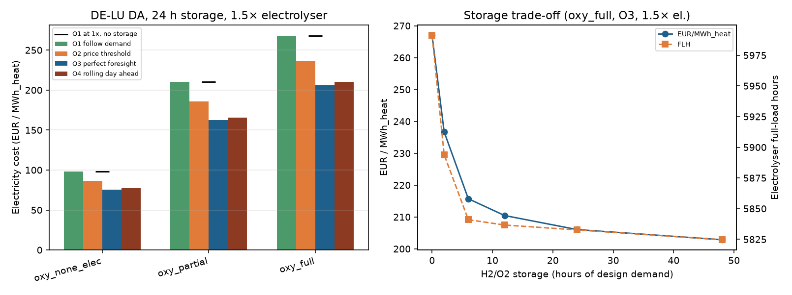
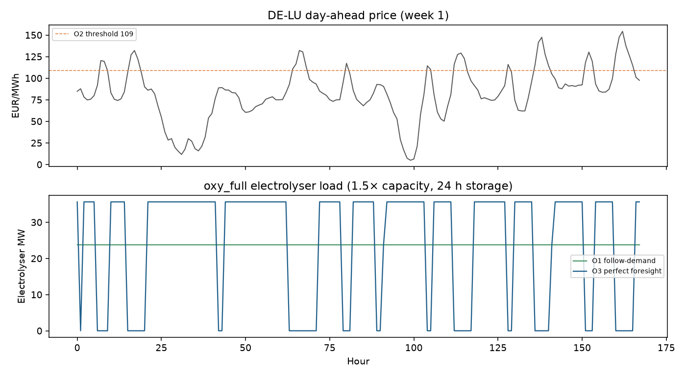
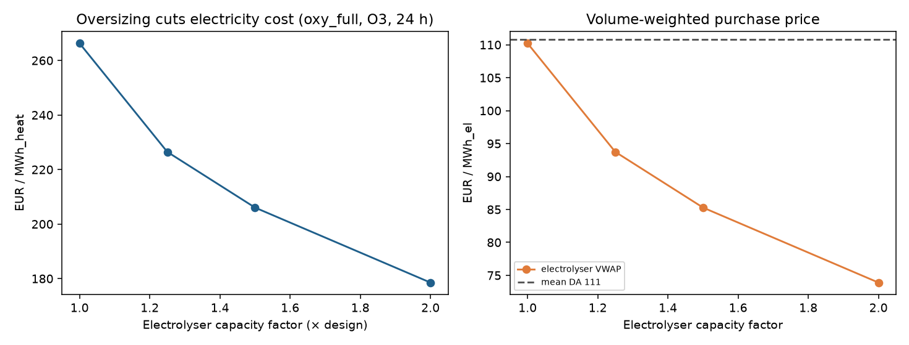

# Biomass Heat — Electrolysis Dispatch

Price-dependent operation of the electrolyser and H₂/O₂ storage for oxyfuel biomass
process-heat chains, on **real German (DE-LU) day-ahead prices**.

Part of the [Biomass Process Heat](https://github.com/DataWithSyed/biomass-process-heat)
series. Installs the plant model as a dependency:

```bash
pip install git+https://github.com/DataWithSyed/biomass-heat-plant-model.git
```

## Problem

Oxyfuel gasification with methanation needs a steady H₂ flow (and co-produces surplus O₂).
Running the electrolyser flat at the design point pays the full day-ahead price every hour.
With H₂/O₂ storage — and some electrolyser oversizing — the same average H₂ can be made in
cheap hours. How much does that cut electricity cost (EUR per MWh of process heat)?

## Method

1. **Design point** from [`biomass-heat-plant-model`](https://github.com/DataWithSyed/biomass-heat-plant-model)
   at 10 MW / 1000 °C for `oxy_partial`, `oxy_full`, `oxy_none_elec`.
2. **Prices**: hourly DE-LU day-ahead from the
   [Energy-Charts](https://api.energy-charts.info) API (Fraunhofer ISE), **CC BY 4.0**;
   underlying source Bundesnetzagentur | [SMARD.de](https://www.smard.de).
   Window used here: **2025-10-30 → 2026-10-30** (8,761 h, mean **110.8 EUR/MWh**).
3. **Strategies**
   * **O1 follow-demand** — electrolyser tracks the hourly H₂ need.
   * **O2 price threshold** — run at capacity when price ≤ series median; else draw storage
     (`PriceThreshold` in the plant model).
   * **O3 perfect foresight** — single-horizon LP (HiGHS) minimising electrolyser cost
     subject to H₂/O₂ storage (upper bound).
   * **O4 rolling day-ahead** — 48 h look-ahead LP, commit 24 h, SOC carried between days.
4. **Sizing**: storage duration (0–48 h of design demand) and electrolyser oversizing
   (1–2 × continuous rating). Agent settlement matches `Plant.simulate` for constant duty
   (fast path + cross-check test).

## Key results (v0.1)

**Base case: 1.5 × electrolyser + 24 h H₂/O₂ storage.** At 1.0 × capacity there is almost
no arbitrage headroom (O3 saves &lt; 1 % vs O1); oversizing is the real lever.

| Config | O1 EUR/MWh_heat | O2 | O3 | O4 | O3 as % of O1 | O3 VWAP EUR/MWh_el |
|---|---|---|---|---|---|---|
| oxy_none_elec | 98.4 | 86.7 | **75.4** | 77.0 | 77 % | 85.0 |
| oxy_partial | 210.1 | 185.7 | **162.3** | 165.8 | 77 % | 85.7 |
| oxy_full | 268.1 | 236.4 | **206.1** | 210.5 | 77 % | 85.3 |

O4 recovers **93–98 %** of the O3 saving. Volume-weighted purchase price falls from the
time-weighted mean 110.8 to ~85 EUR/MWh_el under O3.

**Oversizing (oxy_full, O3, 24 h storage):**

| Capacity factor | EUR/MWh_heat | FLH | VWAP EUR/MWh_el |
|---|---|---|---|
| 1.0 × | 266.3 | 8,749 | 110.2 |
| 1.25 × | 226.5 | 6,999 | 93.7 |
| 1.5 × | 206.1 | 5,833 | 85.3 |
| 2.0 × | **178.5** | 4,375 | 73.9 |

**Storage at 1.5 × (oxy_full, O3):** most of the gain arrives by ~6–12 h
(0 h → 267, 6 h → 216, 24 h → 206, 48 h → 203 EUR/MWh_heat).







## How to run

```bash
python -m venv .venv && source .venv/bin/activate
pip install -r requirements.txt
# optional refresh (CC BY 4.0; see attribution in bhed.prices)
python scripts/fetch_prices.py
python scripts/run_dispatch.py
pytest -q
```

## Assumptions and limitations

See [docs/assumptions.md](docs/assumptions.md). Electricity cost only — no biomass fuel
cost, CAPEX or O₂ sales (those belong in `biomass-heat-lcoh`). Constant 10 MW heat duty.
Ideal storage; O3 is an upper bound; O4 carries SOC but has a 48 h look-ahead only.

## Licence

MIT. Price data: Energy-Charts.info (Fraunhofer ISE), CC BY 4.0; source SMARD.de.
